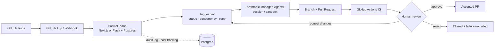

# Software Factory

> Turn your engineering backlog into verified, review-ready pull requests — with controlled execution, visibility, and human approval.

A 30-day Build in Public experiment (26 Oct – 24 Nov 2026) by Ray Shih, solo founder.

Landing page: https://rayshih.github.io/software-factory/
中文：https://rayshih.github.io/software-factory/zh-tw/

## Thesis
Coding agents can already write code. What teams lack is the *factory* around them: a queue, execution control, failure recovery, CI verification, human review, an audit trail and cost visibility. Software Factory is that control layer — built by integrating existing infrastructure, not by building another agent.

## Architecture

## What it does (MVP)
- Receives labelled GitHub issues via a GitHub App, persists tasks idempotently
- Queues work with global and per-repo concurrency limits
- Runs each task in an agent session with timeouts, retries and failure handling
- Opens a branch + PR (retries never create duplicate PRs), waits for CI
- Requires human review on every PR; records cost, interventions and failure causes

## Not doing
SaaS onboarding, billing, RBAC/SSO, multi-tenancy, a custom agent harness, a custom scheduler, multi-model routing, auto-merge, deploy automation.

## Status
Day 1 — planning. No working pipeline yet. Results will be published here as they happen, including failures. See [PLAN.md](PLAN.md), [SETUP.md](SETUP.md) (GitHub App and repo safety), and [benchmarks](benchmarks/BENCHMARK_ISSUES.md).

## Join the pilot
Startup CTO or engineering lead with a growing maintenance backlog? I'm looking for a few design partners to try this on real (low-risk) issues.
👉 [Apply for the pilot](https://docs.google.com/forms/d/e/1FAIpQLSfZh7CwGon-JaBn3jCNt1xi-JmAb0YNw9LavTTHIvuqcaiMLQ/viewform) · [中文版表單](https://docs.google.com/forms/d/e/1FAIpQLSdcu59DEmhPY6L9ACcldA_53HfuP5lw2MU3i88GKfy2r6gr9g/viewform)
