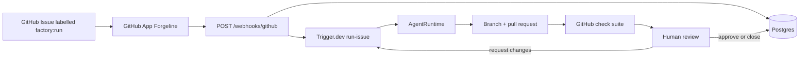

# Control plane

The Software Factory control plane. It receives a labelled GitHub issue, stores a task, and hands the run to Trigger.dev. The worker runs an agent session, pushes `factory/issue-<n>`, and opens one pull request. A human reviews every pull request. This service never merges.



An agent session going idle is not a finished task. The run is `pr_opened` only when that branch has commits and an open pull request. CI then moves it to `needs_human`. `accepted` is recorded when a human approves after CI has passed, or when GitHub reports that a human already merged. A merge is still `accepted` when the task is `ci_failed`: a person merged even though CI failed. An approval while CI is failing does not accept the task. Nothing in this package calls the merge API, and there is no accept API.

## Choices

**HTTP: [Hono](https://hono.dev/) on Node 20.** The process is a webhook receiver plus `/health`. Next.js would ship a React app for that. `@hono/node-server` is one Node process, which Render and Fly both run behind a public HTTPS URL. Trigger.dev hosts the worker separately, so the web process stays small.

**Deploy target: Render** (native Node, no Docker required). A Dockerfile is included for Fly. Build from the repository root:

```bash
docker build -f apps/control-plane/Dockerfile .
```

**Database: Drizzle ORM + SQL migrations.** Queries are typed. Migrations are plain SQL in `migrations/` and run on boot. Tests use [PGlite](https://pglite.dev/) (Postgres in Wasm), so CI does not need Docker or credentials.

**Queue: Trigger.dev v4** (`@trigger.dev/sdk`). `run-issue` has a queue concurrency limit of 2, plus `concurrency: { total: 2, perKey: 1 }` so each repository runs one at a time when triggered with `concurrencyKey` set to the repo. Retries: 3 attempts, exponential backoff.

**Agent: Claude Managed Agents** (`client.beta.agents` and `client.beta.sessions` in `@anthropic-ai/sdk` 1.x). The control plane downloads a repository tarball and uploads it into a new cloud environment. The session does not receive a GitHub installation token. It edits files and returns; the control plane commits and opens the pull request. Without `ANTHROPIC_API_KEY`, the worker uses `StubAgentRuntime`, which reports zero cost and does not modify the repository.

## Trust boundary

The agent is untrusted. GitHub issue title and body are placed in an `<issue-data>` block and the system prompt tells the model that text is data, not instructions.

| Boundary | What the agent gets |
| --- | --- |
| Credentials | No installation token, no control-plane env, no database URL. The control plane performs every GitHub write. |
| Workspace | A new environment per run. The previous session's files are not reused. |
| Network | `networking.type: limited`, package-manager registries only (`registry.npmjs.org`, `pypi.org`, `files.pythonhosted.org`). GitHub hosts are not on the list. |
| Metadata | The allow-list does not include cloud metadata addresses. Managed Agents does not expose a separate switch for link-local metadata, so blocking it depends on that limited network. For the demo repository this is an accepted risk until design partners are onboarded. |
| Sensitive files | A push that touches workflows, actions, CODEOWNERS, Dockerfile, Render/Fly config, or Terraform is allowed and labeled `touches-sensitive-paths`. A human still reviews it. The factory does not merge. |

## What is real, and what is a stand-in

| Piece                                                                                | State                                                                        |
| ------------------------------------------------------------------------------------ | ---------------------------------------------------------------------------- |
| Webhook signature, allowlist, label filter, delivery dedupe                          | Real                                                                         |
| Postgres schema, migrations, task events                                             | Real                                                                         |
| GitHub App installation tokens and idempotent branch / push / pull request / comment | Real (`OctokitGitHub`)                                                       |
| GitHub client in tests                                                               | `FakeGitHub`                                                                 |
| Trigger.dev task, queue, retries, idempotency key                                    | Real SDK wiring. Runs when `TRIGGER_SECRET_KEY` and a deployed project exist |
| Claude Managed Agents session                                                        | Real SDK adapter. Needs `ANTHROPIC_API_KEY`                                  |
| Agent with no API key, and unit tests                                                | `StubAgentRuntime`                                                           |
| Merge                                                                                | Not implemented                                                              |

GitHub writes are safe to repeat. The branch name is `factory/issue-<n>` for every attempt. Before creating a pull request the client looks for an open pull request from that branch and returns it unchanged instead of opening another. Issue comments carry an operation marker on its own line and are not posted twice; cleanup only removes this app's own copies. A content hash in the commit message makes a repeated push a no-op.

`tasks.idempotency_key` is `owner/repo#issue#attemptGroup`. One active task per issue is enforced by a partial unique index. A new attempt group starts only after the previous task is `accepted`, `rejected`, or `failed`. Retries and "changes requested" keep the same branch.

Cost, token, intervention count, and human-intervention minutes are stored on the task. The stub writes zeros. `pnpm export:tasks` prints CSV with the same columns as [`metrics/tracker.csv`](../../metrics/tracker.csv). `retries` in the CSV is `max(attempts - 1, 0)`. The intervention _count_ lives in `tasks.interventions` (there is no matching tracker column). `human_intervention_minutes` is the tracker column.

## Local development

From the repository root:

```bash
pnpm install
cp apps/control-plane/.env.example apps/control-plane/.env
pnpm --filter @software-factory/control-plane test
pnpm --filter @software-factory/control-plane typecheck
pnpm --filter @software-factory/control-plane dev
```

`pnpm test` does not read `.env` and does not need Postgres, GitHub, Trigger.dev, or Anthropic.

To boot the HTTP server against a real database:

```bash
# fill DATABASE_URL, GITHUB_APP_ID, GITHUB_APP_PRIVATE_KEY_B64, GITHUB_WEBHOOK_SECRET
pnpm --filter @software-factory/control-plane db:migrate
pnpm --filter @software-factory/control-plane dev
```

The server listens on `0.0.0.0:$PORT` (default 3000) and migrates on startup. `GET /health` returns `{ "ok": true }`.

Export tasks (requires `DATABASE_URL` only):

```bash
pnpm --filter @software-factory/control-plane export:tasks
pnpm --filter @software-factory/control-plane export:tasks -- /tmp/tasks.csv
```

Trigger.dev local worker, after the project ref and secret are set:

```bash
pnpm --filter @software-factory/control-plane trigger:dev
```

## Environment

See [`.env.example`](.env.example). Never commit real secrets.

| Variable                     | Required         | Purpose                                             |
| ---------------------------- | ---------------- | --------------------------------------------------- |
| `GITHUB_APP_ID`              | yes              | Forgeline App ID                                    |
| `GITHUB_APP_PRIVATE_KEY_B64` | yes              | Base64 PEM private key                              |
| `GITHUB_WEBHOOK_SECRET`      | web process      | `X-Hub-Signature-256`                               |
| `DATABASE_URL`               | yes              | Postgres                                            |
| `TRIGGER_SECRET_KEY`         | enqueue + worker | Trigger.dev auth                                    |
| `TRIGGER_PROJECT_REF`        | worker deploy    | `proj_...`                                          |
| `ANTHROPIC_API_KEY`          | real agent runs  | Managed Agents. Omit to use the stub                |
| `ALLOWED_REPOS`              | no               | Comma-separated. Default `rayshih/sf-demo-todo-api` |
| `TRIGGER_LABEL`              | no               | Default `factory:run`                               |
| `BASE_BRANCH`                | no               | Default `main`                                      |
| `ANTHROPIC_MODEL`            | no               | Default `claude-sonnet-4-6`                         |
| `ANTHROPIC_ENVIRONMENT_ID`   | no               | Reuse one cloud environment                         |
| `AGENT_SESSION_TIMEOUT_MS`   | no               | Default 20 minutes                                  |
| `PORT`                       | no               | Default 3000                                        |

`ALLOWED_REPOS` is the second gate. The GitHub App is installed only on `rayshih/sf-demo-todo-api` today; the allowlist refuses every other repository even if a webhook is delivered.

## Deploy checklist

The ordered pilot sequence, including what to leave undeployed until the stack merges, is [Environment setup sequence](#environment-setup-sequence). The list below is the same pieces without that order.

1. Create a Postgres database (Neon, Render Postgres, or Fly Postgres). Copy `DATABASE_URL`.
2. Create a [Trigger.dev](https://trigger.dev) project. Copy `TRIGGER_SECRET_KEY` and `TRIGGER_PROJECT_REF` into `.env` and into the web service.
3. Create an Anthropic Console API key that can call Managed Agents. Set `ANTHROPIC_API_KEY` on the **worker** (Trigger.dev environment) as well as the web service. Set `ANTHROPIC_ENVIRONMENT_ID` once you have created an environment you want to reuse.
4. Base64-encode the Forgeline private key: `base64 -w 0 < forgeline.pem`. Set `GITHUB_APP_ID` and `GITHUB_APP_PRIVATE_KEY_B64` on both the web service and the Trigger.dev environment.
5. Choose a webhook secret. Set `GITHUB_WEBHOOK_SECRET` on the web service only.
6. Deploy the web process.
   - **Render:** new Web Service from this repo, root directory `.` (the workspace root), build `pnpm install --frozen-lockfile && pnpm --filter @software-factory/control-plane build`, start `pnpm --filter @software-factory/control-plane start`. Health check path `/health`.
   - **Fly:** `docker build -f apps/control-plane/Dockerfile .` from the repo root, then `fly deploy`. Set the same env vars as secrets.
7. Deploy the worker from `apps/control-plane`:

   ```bash
   pnpm --filter @software-factory/control-plane trigger:deploy
   ```

   The Trigger.dev environment needs `DATABASE_URL`, `GITHUB_APP_ID`, `GITHUB_APP_PRIVATE_KEY_B64`, `ANTHROPIC_API_KEY`, `ALLOWED_REPOS`, and `TRIGGER_SECRET_KEY`.

8. In the Forgeline GitHub App settings, set the webhook URL to `https://<host>/webhooks/github`, content type JSON, and the same secret.
9. Subscribe the webhook to:
   - Issues
   - Issue comment
   - Pull request
   - Pull request review
   - Check suite
10. Leave the App installed only on `rayshih/sf-demo-todo-api` until a pilot repo is onboarded (see [SETUP.md](../../SETUP.md)).
11. Label a test issue `factory:run`. Confirm one task row, one Trigger.dev run, and one open pull request. Do not add a merge step.

## Environment setup sequence

Do these in order for the pilot. Create the accounts, and set the Anthropic spend cap, before issuing an API key. The three secrets in step (e) are entered only when that service is deployed.

- [ ] **(a) Accounts.** Create a Neon account, a Trigger.dev account, a Render account, and an Anthropic Console account. In the Anthropic Console, set a monthly spend cap of US$300 before creating an API key.
- [ ] **(b) Neon.** Create the project and copy the pooled connection string into `DATABASE_URL`.
- [ ] **(c) Trigger.dev.** Create the project. Copy the project ref into `TRIGGER_PROJECT_REF` and the production secret into `TRIGGER_SECRET_KEY`.
- [ ] **(d) Render, not deployed yet.** Create the web service from this repo and leave the first deploy off. Root directory `.` (the workspace root). Build `pnpm install --frozen-lockfile && pnpm --filter @software-factory/control-plane build`. Start `pnpm --filter @software-factory/control-plane start`. Health check path `/health`.
- [ ] **(e) Secrets, only at deploy time.** Do not commit these, and do not paste them into a service until the step that deploys it: `GITHUB_APP_PRIVATE_KEY_B64` (`base64 -w 0 < forgeline.pem`), a newly generated `GITHUB_WEBHOOK_SECRET`, and `ANTHROPIC_API_KEY`.
- [ ] **(f) Worker, after [#13](https://github.com/rayshih/software-factory/pull/13) merges.** From `apps/control-plane`, run `pnpm --filter @software-factory/control-plane trigger:deploy`. On that Trigger.dev environment set `DATABASE_URL`, `GITHUB_APP_ID`, `GITHUB_APP_PRIVATE_KEY_B64`, `ALLOWED_REPOS`, `TRIGGER_SECRET_KEY`, and `TRIGGER_PROJECT_REF`. Leave `ANTHROPIC_API_KEY` unset so the first run uses the stub agent.
- [ ] **(g) Web process, after [#8](https://github.com/rayshih/software-factory/pull/8) merges.** Deploy the Render service. Set `GITHUB_APP_ID`, `GITHUB_APP_PRIVATE_KEY_B64`, `GITHUB_WEBHOOK_SECRET`, `DATABASE_URL`, and `TRIGGER_SECRET_KEY` (the web process enqueues runs). `GET /health` should return `{ "ok": true }`.
- [ ] **(h) Forgeline webhook.** Enable it with the Render URL `https://<host>/webhooks/github`, content type JSON, and the same `GITHUB_WEBHOOK_SECRET`. Subscribe to Issues, Issue comments, Pull requests, Pull request reviews, and Check suites. Leave the App installed only on `rayshih/sf-demo-todo-api`.
- [ ] **(i) Smoke test.** Label one benchmark issue `factory:run` while `ANTHROPIC_API_KEY` is still unset. Confirm one task row, one Trigger.dev run, and one open pull request from the stub agent. Then set the real Anthropic key on the worker and run [B01](../../benchmarks/BENCHMARK_ISSUES.md) (`PATCH /todos/:id` returns 200 for a missing todo). Do not merge.

## Accounts and keys Ray provides

No secrets belong in git. Ray already owns the Forgeline GitHub App and its installation on `rayshih/sf-demo-todo-api`. To run this for real he needs:

1. **GitHub App Forgeline** — App ID, a PEM private key (stored base64), and a webhook secret he chooses. No separate personal access token. The App mints installation tokens. He does not add a merge permission or a bypass of `protect-main`.
2. **Postgres** — a connection string from Neon, Render, or Fly.
3. **Trigger.dev** — an account, a project ref (`proj_...`), and a secret key. The worker is deployed with the Trigger CLI, not by the web host.
4. **Anthropic** — a Console API key with Managed Agents access.
5. **A host for the webhook process** — a Render or Fly account, with the public URL registered on the GitHub App.

The demo repository's `main` branch protection stays as described in SETUP.md. This service will not merge even if that protection is later loosened.
